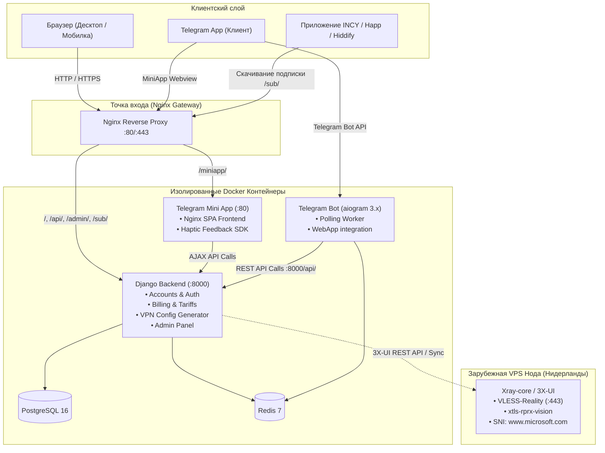
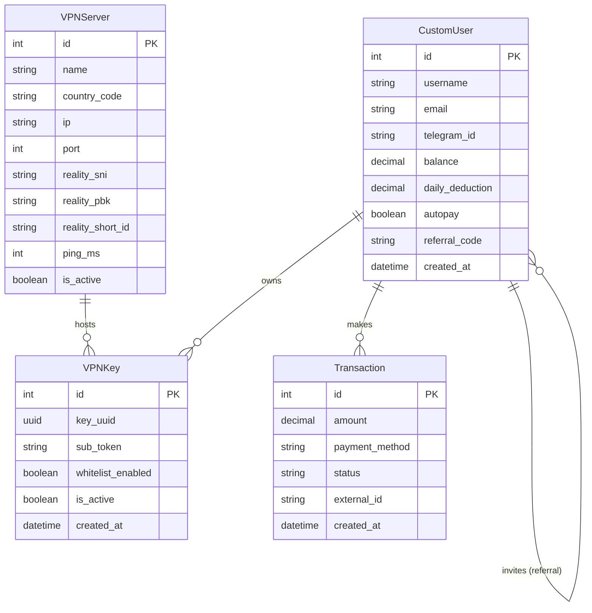

# 🏗️ Техническая архитектура и документация: VPN Live Dev

## 1. Общая схема взаимодействия компонентов

---

## 2. Белые списки РФ и РБ (Direct Routing)

### Проблема:
При использовании классических зарубежных VPN в России и Беларуси перестают работать:
* Банковские приложения (Сбер, Т-Банк, ВТБ, Альфа-Банк) из-за антифрод-защиты.
* Государственные сервисы (Госуслуги, Налог.ру, Мос.ру).
* Российские стриминги и маркетплейсы (Кинопоиск, Иви, Ozon, Wildberries, Авито, Яндекс.Маркет).

### Решение:
В подписке и PAC-скриптах настраивается динамическая маршрутизация:
1. **Правило `direct` (напрямую):**
   * Все доменные зоны: `.ru`, `.рф`, `.su`, `.by`.
   * Список критических государственных и банковских доменов.
2. **Правило `proxy` (через туннель VLESS Reality):**
   * Все заблокированные и зарубежные ресурсы: `instagram.com`, `facebook.com`, `twitter.com / x.com`, `youtube.com`, `googlevideo.com`, `chatgpt.com / openai.com`, торренты и медиа.
3. **Управление:**
   * В веб-кабинете и в Telegram-боте доступен тумблер `Белый список РФ`. При выключении весь трафик идет через Нидерланды (полезно для пользователей за рубежом, желающих скрыть свой IP полностью).

---

## 3. Схема базы данных (ERD)

---

## 4. Спецификация REST API (`/api/`)

| Метод | URL | Описание | Параметры |
|---|---|---|---|
| `POST` | `/api/tg/sync/` | Синхронизация Telegram пользователя с бэкендом (создание ключа, возврат баланса) | `telegram_id`, `telegram_username`, `ref_code` |
| `POST` | `/api/vpn/toggle-whitelist/` | Переключение белого списка РФ для ключа | `telegram_id` или `user_id` |
| `GET` | `/api/vpn/servers/` | Список доступных локаций и их пинг | — |
| `GET` | `/api/billing/tariffs/` | Список активных тарифных планов | — |
| `GET` | `/sub/<sub_token>/` | Универсальная Base64 подписка для INCY / Happ | — |
| `GET` | `/vpn/pac/<sub_token>/` | PAC-скрипт авто-прокси для подключения без программ | — |
| `GET` | `/vpn/qr/<sub_token>/` | PNG/SVG изображение QR-кода ключа | — |

---

## 5. Модель монетизации и списаний (Daily Billing)

* **Посуточное списание:**
  * Вместо блокировки доступа на месяц сервис списывает фиксированную сумму в день (по умолчанию **3.50 ₽ / сутки**).
  * Позволяет привлекать пользователей с небольшим бюджетом (можно положить 50–100 ₽ и пользоваться 2–4 недели).
* **Триал период:**
  * Каждому новому пользователю при регистрации начисляется **15.00 ₽** (3 дня бесплатного быстрого доступа для проверки качества).
* **Реферальная система:**
  * За каждого приглашенного пользователя, зарегистрировавшегося по реферальной ссылке, пригласившему начисляется **+10.00 ₽** на баланс.
